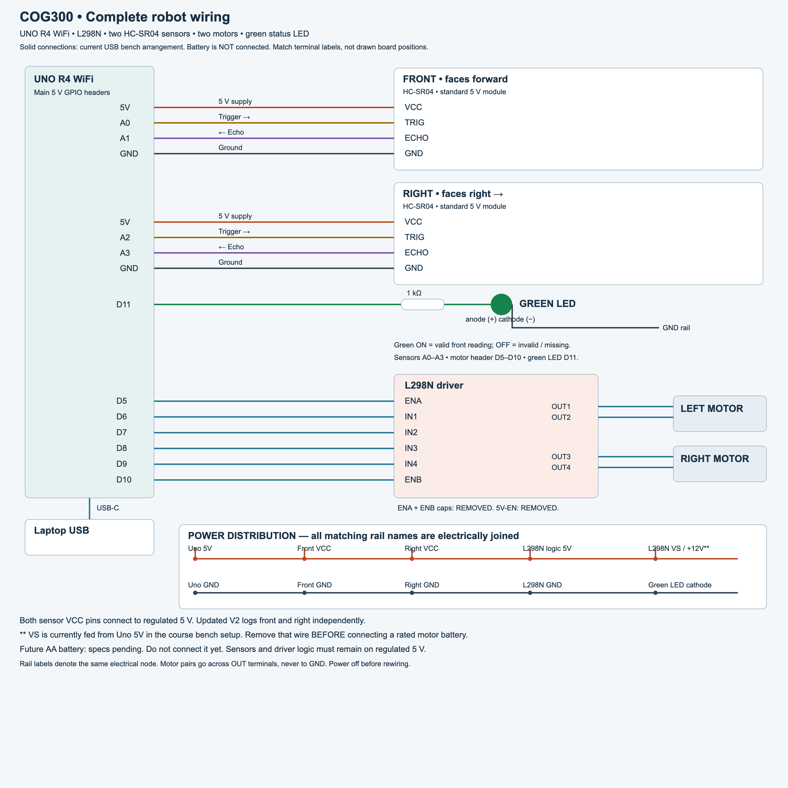
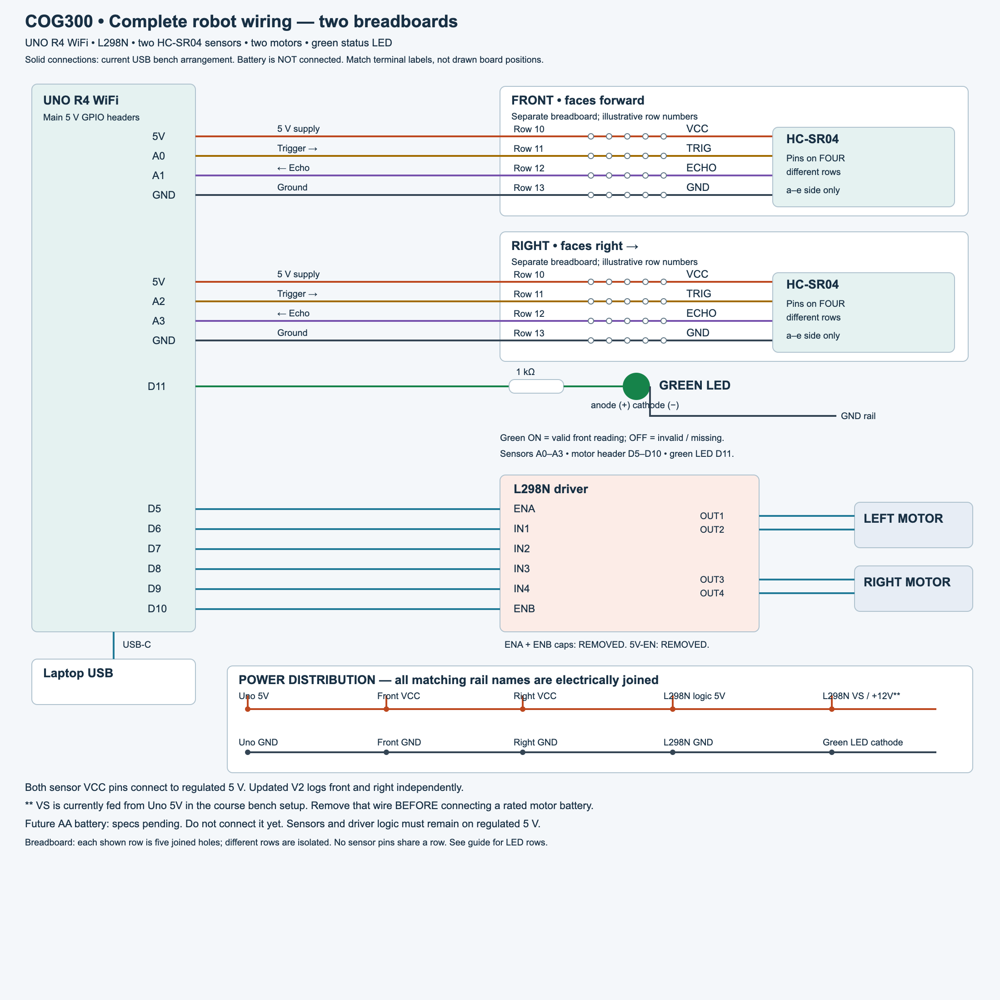

# Rebuild: front and right ultrasonic sensors

Signal wiring unchanged as of 2026-10-28. Target: UNO R4 WiFi, common L298N module and two standard 5 V HC-SR04 sensors. This is a connection schematic, not a physical breadboard layout. Confirm component labels before connecting.

## Complete diagrams

These replace the earlier separate sensor and motor diagrams as the current rebuild reference.



[Full-size wiring SVG](../wiring/robot-complete-wiring.svg)



[Full-size breadboard SVG](../wiring/robot-complete-breadboards.svg)

## Sensor connections

| Sensor terminal | Front sensor (existing) | Right sensor (new) |
| --- | --- | --- |
| VCC | Uno 5V rail | Same Uno 5V rail |
| TRIG | A0 | A2 |
| ECHO | A1 | A3 |
| GND | Common GND rail | Same common GND rail |

Both sensors now occupy adjacent pairs on the analog header, used as digital GPIO: front A0/A1, right A2/A3. On UNO R4 WiFi with Arduino Renesas core 1.6.0, A1 maps to P000 / IRQ6 and A3 to P002 / IRQ2. These are separate interrupt channels, so echo timing can remain interrupt-based. A0/A2 are digital trigger outputs, not analog distance inputs. This mapping is specific to UNO R4 WiFi; do not assume the same interrupt support on an Uno R3.

Motor signals follow the L298N control-header order across D5–D10. ENA on D5 and ENB on D10 both support PWM. Green stays D11. D0/D1 (UART), D2–D4, D12/D13 and A4/A5 remain free. Use the main Uno headers, not the ESP32 or Qwiic connectors. Echo connections are for this 5 V Uno board; do not transfer this wiring to a 3.3 V board without checking its input limits.

Mount the front sensor facing straight ahead. Mount the right sensor facing directly right, perpendicular to forward travel, with both transducers clear of the chassis and wiring. Right means the robot's right when facing forward. Keep the right sensor level and facing the wall; measure the desired wall distance from its sensor face. Secure the mount so it does not rotate during turns.

## Existing connections

| Uno pin / component | Connection |
| --- | --- |
| D5 / D6 / D7 | L298N ENA / IN1 / IN2 |
| D8 / D9 / D10 | L298N IN3 / IN4 / ENB |
| OUT1 + OUT2 | Left motor pair |
| OUT3 + OUT4 | Right motor pair |
| D11 | 1 kΩ resistor → green LED anode |
| Green LED cathode | GND |
| Uno GND | Both sensors, green LED return and L298N GND |

Remove the ENA and ENB caps for PWM. These are different from the 5V-EN regulator jumper. Remove the red LED, its resistor and its old D12 wire. D12 is now unused. Green remains on D11. Green on means a valid front reading at any accepted distance; off means invalid or missing. In MANUAL, sensor readings do not stop motion. Autonomous modes use their own distance-stop rules; see [autonomous modes](autonomous-modes.md).

## Historical rebuild sequence (2026-10-21)

The software cleanup does not require repeating this rewiring. These steps document the earlier transition.

1. Disconnect USB and any motor supply. Rewire using the table below; this revision changes sensor AND motor pins. Do not run the new firmware on the old wiring.

   | Connection | Previous pin | New pin |
   | --- | --- | --- |
   | Front TRIG | D4 | A0 |
   | Front ECHO | D2 | A1 |
   | Right TRIG | D12 (earlier proposal) | A2 |
   | Right ECHO | D3 (earlier proposal) | A3 |
   | ENA | D9 | D5 |
   | IN1 | D8 | D6 |
   | IN2 | D7 | D7 |
   | IN3 | D6 | D8 |
   | IN4 | D5 | D9 |
   | ENB | D10 | D10 |
   | Green LED | D11 | D11 |

2. Add the right sensor mount and four connections from the table. Use a shared 5 V rail and shared GND rail; bridge rail breaks if your breadboard has split rails.
3. Check printed VCC/TRIG/ECHO/GND labels on each sensor, rail polarity, and that A1 and A3 echoes are separate. Do not join the trigger lines either.
4. For this sensor-only rebuild, retain the already verified USB bench power configuration described in the power reference. Do not add the battery yet.
5. With motor power disconnected, upload the updated V2 sketch after completing the rewiring. Reconnect for testing with the wheels raised. V2 now reads both sensors; use `LOG ON` to check that the existing front readings and green validity LED still work.
6. With power off, connect right sensor VCC to the same regulated 5V source as the front sensor. Upload this dual-sensor V2 before testing.
7. Verify front and right readings independently against a ruler, then verify them together before enabling autonomous motion.

## Battery transition (design pending)

The goal is to move motor current off the Arduino 5 V supply. A battery is not a direct replacement for the regulated 5 V rail used by the sensors.

The proposed first stage keeps USB powering the Uno and its regulated 5 V logic rail, while a separately rated battery powers only the motors:

```text
USB → Uno USB-C
Uno 5V → both sensor VCC pins + L298N logic 5V
Battery + → appropriately rated fuse / switch → L298N VS (+12V-labelled terminal)
Battery − → L298N GND
Uno GND → L298N GND + both sensor grounds + green LED return
REMOVE the old Uno 5V → L298N VS wire before connecting the battery.
```

This assumes the existing common-module configuration with **5V-EN removed** and externally supplied logic 5 V. Do not connect an enabled module regulator output to Uno 5V. Motor current should go directly through suitable battery/driver wiring, not through the Uno or solderless breadboard rails.

**Do not wire the battery stage until its voltage/type, full-charge voltage, motor rating and exact driver module are known.** Battery, switch, fuse and wiring must suit motor startup/stall current and the module's actual limits. The L298 IC datasheet alone does not establish the limits of a complete module.

For fully untethered operation, the Uno also needs a suitable supply path. The UNO R4 WiFi documents VIN/barrel input of 6–24 V, but that range is not a motor battery recommendation. Choose VIN/barrel or a suitable regulated USB supply only after checking the pack and power arrangement. Never feed raw battery voltage into Uno 5V, sensor VCC or the L298N logic 5V terminal.

## Next software milestone

V2 now reads both sensors, alternating one ping every 70 ms (140 ms per sensor). LOG ON displays both distances independently; stale readings expire after 350 ms. Hardware cross-talk and accuracy still need ruler checks. Autonomous modes are a separate layer above acquisition.

P control will regulate distance to the right wall. Corner handling needs additional states: front obstruction can require a left turn; loss of the right wall may indicate an outside corner, doorway, poor echo or sensor failure. Missing echo alone must not trigger a blind right turn. Tune P control and validate corner behavior separately after sensor and power checks.

## Sources

- [Arduino UNO R4 WiFi pinout](https://docs.arduino.cc/resources/pinouts/ABX00087-full-pinout.pdf): main-header pins and voltage domains.
- [UNO R4 WiFi core 1.6.0 pin mapping](https://github.com/arduino/ArduinoCore-renesas/blob/1.6.0/variants/UNOWIFIR4/variant.cpp) and [interrupt capabilities](https://github.com/arduino/ArduinoCore-renesas/blob/1.6.0/variants/UNOWIFIR4/pinmux.inc): A1/P000/IRQ6 and A3/P002/IRQ2. Verified against the installed core.
- [Arduino interrupt reference](https://github.com/arduino/reference-en/blob/master/Language/Functions/External%20Interrupts/attachInterrupt.adoc): D2/D3 interrupt support.
- [UNO R4 WiFi hardware documentation](https://docs.arduino.cc/hardware/uno-r4-wifi/): power input range.
- [HC-SR04 datasheet](https://cdn.sparkfun.com/datasheets/Sensors/Proximity/HCSR04.pdf): 5 V supply, trigger/echo interface and measurement-cycle guidance.
- [ST L298 datasheet](https://www.st.com/resource/en/datasheet/l298.pdf): separate motor and logic supply domains; module regulator behavior still requires the actual module documentation.

## Two-breadboard placement

Use one four-wire harness per sensor. Each harness carries regulated 5V, GND, its own TRIG and its own ECHO. The two breadboards do not need to touch; their grounds and 5V supplies join back at the common distribution point. Do not daisy-chain motor current through either sensor board.

The drawing shows four connected groups of five holes. On a typical solderless breadboard, a–e in one numbered row are connected; f–j are a separate group across the centre gap. Verify your board layout. Row numbers below are examples, not required positions.

| Board | Sensor pin hole | Jumper in same row | Jumper destination |
| --- | --- | --- | --- |
| Front | a10 VCC | e10 | regulated 5V |
| Front | a11 TRIG | e11 | A0 |
| Front | a12 ECHO | e12 | A1 |
| Front | a13 GND | e13 | common GND |
| Right | a10 VCC | e10 | regulated 5V |
| Right | a11 TRIG | e11 | A2 |
| Right | a12 ECHO | e12 | A3 |
| Right | a13 GND | e13 | common GND |

Orient each module so its four header pins occupy four different numbered rows, not a–d of one row. Follow its printed pin order. If mounting geometry prevents direct insertion, use short jumpers from the module to these rows.

The green LED may sit on the front breadboard: D11 → e20; 1 kΩ resistor from a20 to a22; LED anode in b22 and cathode in b23; e23 → common GND. This creates D11 → resistor → LED → ground without shorting either component. No red LED remains.

If using power rails, connect each board's + rail to regulated 5V and − rail to common GND, then route its VCC/GND row jumpers to those rails. Check and bridge rail splits. The two rails are not joined merely because both are marked with the same colour.
