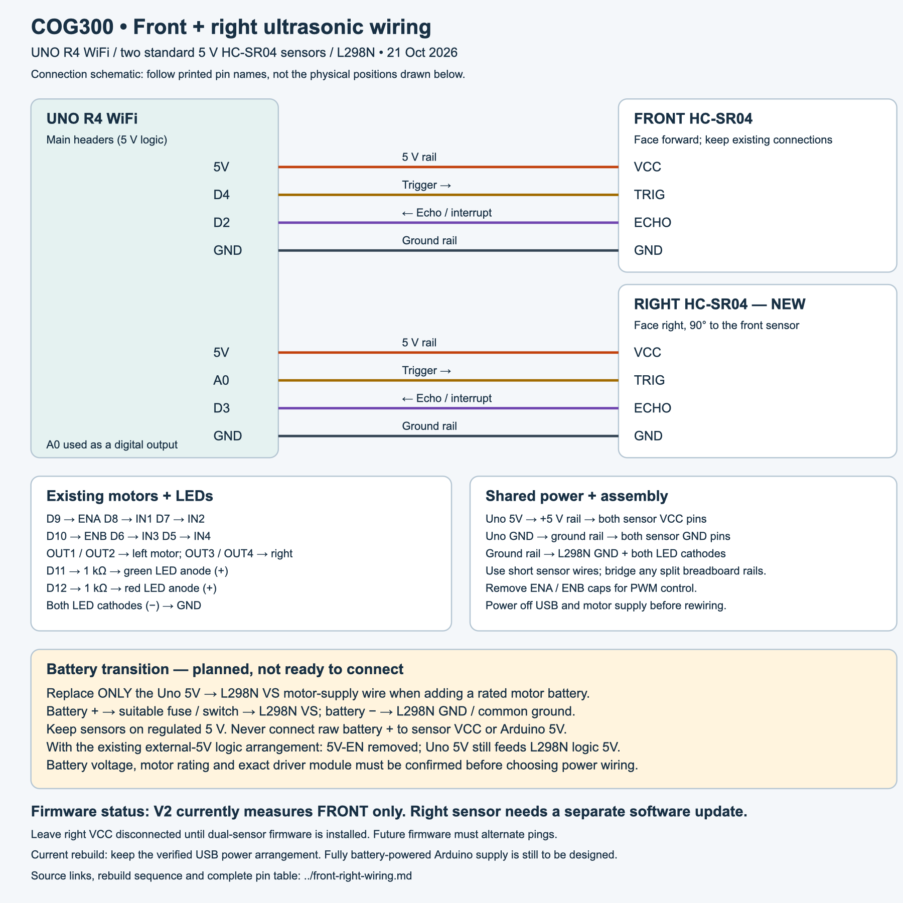

# Rebuild: front and right ultrasonic sensors

Updated 2026-10-21. Target: UNO R4 WiFi, common L298N module and two standard 5 V HC-SR04 sensors. This is a connection schematic, not a physical breadboard layout. Confirm component labels before connecting.



[Full-size SVG](diagrams/uno-r4-front-right-wiring.svg)

## Sensor connections

| Sensor terminal | Front sensor (existing) | Right sensor (new) |
| --- | --- | --- |
| VCC | Uno 5V rail | Same Uno 5V rail |
| TRIG | D4 | A0, used as a digital output |
| ECHO | D2 | D3 |
| GND | Common GND rail | Same common GND rail |

D2 and D3 support external interrupts on UNO R4 WiFi. A0 is available as a digital GPIO and does not conflict with the existing motor or LED pins. Use the main Uno headers, not the ESP32 or Qwiic connectors. Echo connections are for this 5 V Uno board; do not transfer this wiring to a 3.3 V board without checking its input limits.

Mount the front sensor facing straight ahead. Mount the right sensor facing directly right, perpendicular to forward travel, with both transducers clear of the chassis and wiring. Right means the robot's right when facing forward. Keep the right sensor level and facing the wall; measure the desired wall distance from its sensor face. Secure the mount so it does not rotate during turns.

## Existing connections

| Uno pin / component | Connection |
| --- | --- |
| D9 / D8 / D7 | L298N ENA / IN1 / IN2 |
| D10 / D6 / D5 | L298N ENB / IN3 / IN4 |
| OUT1 + OUT2 | Left motor pair |
| OUT3 + OUT4 | Right motor pair |
| D11 | 1 kΩ resistor → green LED anode |
| D12 | 1 kΩ resistor → red LED anode |
| Both LED cathodes | GND |
| Uno GND | Both sensors, LED returns and L298N GND |

Remove the ENA and ENB caps for PWM. These are different from the 5V-EN regulator jumper. Do not change motor polarity or LED wiring for this upgrade.

## Rebuild sequence

1. Disconnect USB and any motor supply. Label the existing front sensor wires.
2. Add the right sensor mount and four connections from the table. Use a shared 5 V rail and shared GND rail; bridge rail breaks if your breadboard has split rails.
3. Check printed VCC/TRIG/ECHO/GND labels on each sensor, rail polarity, and that D2 and D3 echoes are separate. Do not join the trigger lines either.
4. For this sensor-only rebuild, retain the already verified USB bench power configuration described in the power reference. Do not add the battery yet.
5. Reconnect USB with the wheels raised. V2 still reads only the front sensor; use `LOG ON` to check that the existing front readings and LEDs still work.
6. Leave the right sensor VCC disconnected until the dual-sensor firmware is installed, then connect it with power off. This avoids powering a sensor whose trigger is not yet configured by the current firmware.
7. After the next firmware milestone, verify front and right readings independently against a ruler, then verify them together before enabling autonomous motion.

## Battery transition (design pending)

The goal is to move motor current off the Arduino 5 V supply. A battery is not a direct replacement for the regulated 5 V rail used by the sensors.

The proposed first stage keeps USB powering the Uno and its regulated 5 V logic rail, while a separately rated battery powers only the motors:

```text
USB → Uno USB-C
Uno 5V → both sensor VCC pins + L298N logic 5V
Battery + → appropriately rated fuse / switch → L298N VS (+12V-labelled terminal)
Battery − → L298N GND
Uno GND → L298N GND + both sensor grounds + LED returns
REMOVE the old Uno 5V → L298N VS wire before connecting the battery.
```

This assumes the existing common-module configuration with **5V-EN removed** and externally supplied logic 5 V. Do not connect an enabled module regulator output to Uno 5V. Motor current should go directly through suitable battery/driver wiring, not through the Uno or solderless breadboard rails.

**Do not wire the battery stage until its voltage/type, full-charge voltage, motor rating and exact driver module are known.** Battery, switch, fuse and wiring must suit motor startup/stall current and the module's actual limits. The L298 IC datasheet alone does not establish the limits of a complete module.

For fully untethered operation, the Uno also needs a suitable supply path. The UNO R4 WiFi documents VIN/barrel input of 6–24 V, but that range is not a motor battery recommendation. Choose VIN/barrel or a suitable regulated USB supply only after checking the pack and power arrangement. Never feed raw battery voltage into Uno 5V, sensor VCC or the L298N logic 5V terminal.

## Next software milestone

No firmware changes are included in this wiring milestone. Add separate front/right readings and alternate pings rather than triggering both sensors at once. A conservative starting schedule is one ping every 70 ms, alternating front/right (140 ms per sensor); this is a design proposal to test for cross-talk, not a proven timing requirement. Revisit sample age and stopping distance with that reduced per-sensor rate.

P control will regulate distance to the right wall. Corner handling needs additional states: front obstruction can require a left turn; loss of the right wall may indicate an outside corner, doorway, poor echo or sensor failure. Missing echo alone must not trigger a blind right turn. Tune P control and validate corner behavior separately after sensor and power checks.

## Sources

- [Arduino UNO R4 WiFi pinout](https://docs.arduino.cc/resources/pinouts/ABX00087-full-pinout.pdf): main-header pins, A0/D14 and voltage domains.
- [Arduino interrupt reference](https://github.com/arduino/reference-en/blob/master/Language/Functions/External%20Interrupts/attachInterrupt.adoc): D2/D3 interrupt support.
- [UNO R4 WiFi hardware documentation](https://docs.arduino.cc/hardware/uno-r4-wifi/): power input range.
- [HC-SR04 datasheet](https://cdn.sparkfun.com/datasheets/Sensors/Proximity/HCSR04.pdf): 5 V supply, trigger/echo interface and measurement-cycle guidance.
- [ST L298 datasheet](https://www.st.com/resource/en/datasheet/l298.pdf): separate motor and logic supply domains; module regulator behavior still requires the actual module documentation.
