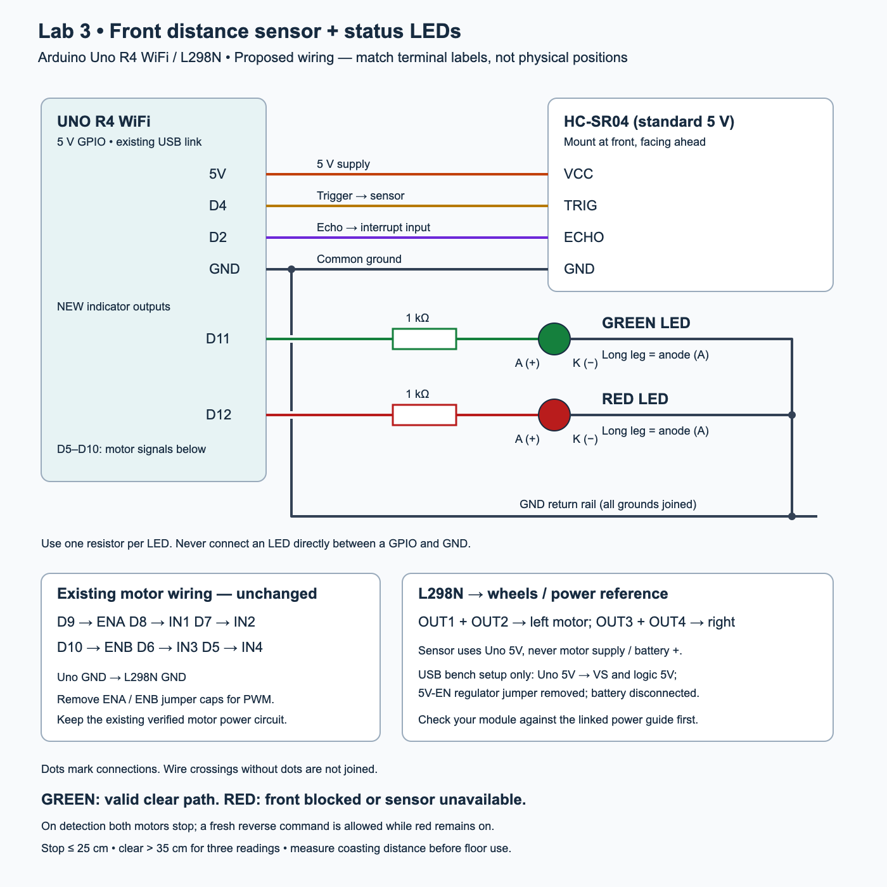

# Historical reference: single HC-SR04 and two LEDs

**Latest rebuild plan:** [front + right ultrasonic wiring and battery transition](front-right-wiring.md). The second sensor is planned hardware; current V2 firmware still reads only the front sensor.

This upgrade targets the **Arduino Uno R4 WiFi** in the current Lab 3 setup. The Arduino enforces the obstacle stop for arrow commands, GUI presets, standalone Serial Monitor commands, and the firmware's automatic suite. Python displays the stop and cancels its remaining preset steps.



[Open the full-size wiring diagram](diagrams/uno-r4-hcsr04-leds.svg). This is a signal schematic, not a breadboard-position drawing. Existing motor power details remain in the [power reference](programming-and-wiring.md).

**Superseded wiring:** the current rebuild removes the red LED and groups front on A0/A1 and right on A2/A3. Use the complete diagrams linked above, not the two-LED diagram below.

## Parts and connections

Use one standard HC-SR04, one green LED, one red LED, **two 1 kΩ resistors** (one per LED), jumper wires, and a breadboard or secure connectors. Power off before wiring.

| Component | Connect to |
| --- | --- |
| HC-SR04 VCC | Uno **5V** |
| HC-SR04 GND | Uno **GND**, shared with L298N |
| HC-SR04 TRIG | Uno **D4** |
| HC-SR04 ECHO | Uno **D2** |
| Green LED anode (+, normally long leg) | **D11 → 1 kΩ resistor → anode** |
| Red LED anode (+, normally long leg) | **D12 → 1 kΩ resistor → anode** |
| Both LED cathodes (−, normally short leg / flat case side) | **GND** |

The resistors can be on either side of their respective LED, as long as each is in series. A 1 kΩ resistor limits even the conservative 5 V / 1 kΩ upper bound to 5 mA. These are ordinary two-lead LEDs, not high-power lamps. Do not connect the sensor to raw motor supply voltage. The Uno R4's main GPIOs operate at 5 V, so standard HC-SR04 echo can connect directly to D2 on this board; this wiring is not for a 3.3 V board.

Motor connections stay D9/D8/D7 for the left channel and D10/D6/D5 for the right. Keep the current motor power configuration; this upgrade does not require changing the motor supply. In the documented USB-only bench arrangement, the L298N regulator jumper is removed and no battery is connected. Confirm the actual module and [power reference](programming-and-wiring.md) before applying power.

Mount the sensor at the front with a clear view, approximately horizontal. Keep wires and chassis parts out of its view. Distance is measured from the sensor face, so account for any bumper or wheel protruding beyond it.

## What the lights and controls mean

| State | Green | Red | Behavior |
| --- | --- | --- | --- |
| Startup / no valid reading | Off | On | Forward and spins blocked |
| Valid clear path | On continuously | Off | Normal controls allowed; green stays on even when stationary |
| Obstacle at or below 10 cm | Off | On | Both motors stop; queued moves and automatic tests cancelled |
| Echo missing, invalid, or stale | Off | On | Stop and block forward; GUI identifies a sensor problem |
| Deliberate reverse while blocked | Off | On | Down/reverse allowed to back away; front remains blocked |

**Red means the front is blocked or unverified.** On detection the car stops, but red stays on during an intentional reverse escape. The sensor cannot check behind the car. Forward curves, single-wheel forward movements and in-place spins are blocked too, because they can swing a corner forward.

After stopping, clearance must exceed **20 cm for three consecutive readings** before green returns. Readings between 10 and 20 cm retain the prior blocked/clear state. Clearing the obstacle does not restart a cancelled test or held arrow: release and press the arrow again, or explicitly restart the test. A new obstacle or sensor failure stops any movement, including reverse; a fresh reverse command is then allowed.

## Upload and run

1. Keep **all four** tabs together in `src/MyRobot-V2/`: `MyRobot-V2.ino`, `Motor.ino`, `Serial.ino`, and **`Safety.ino`**.
2. In Arduino IDE select **UNO R4 WiFi** and the correct USB port. Upload `MyRobot-V2.ino`.
3. Close Serial Monitor and Plotter. Run the updated `controller/Launch Robot Controller.command`.
4. Connect, inspect the sensor status, and enable controls with the wheels raised for the first check.

Firmware/controller protocol is now **3**; use this firmware and Python controller together. The GUI demo does not simulate the sensor or prove obstacle protection. Standalone Serial Monitor still works at 9600 baud with Newline; `STATUS` includes the sensor state and last measured distance. GUI sensor text reports status transitions, not a continuously refreshed distance display.

## Timing and threshold tuning

`Safety.ino` contains `STOP_CM = 10`, `CLEAR_CM = 20`, `PING_MS = 70`, and `STALE_MS = 250`. Echo edges are captured on D2 with an interrupt; no PWM timer library is used. The only sensor delay is a 10 µs trigger pulse. A missing echo times out after 30 ms and blocks forward. An old valid sample expires after 250 ms. An absent echo can also mean an object is out of range or reflects poorly; it is deliberately treated as unknown, not proof of clearance.

**10 cm is a starting value, not a verified stopping distance.** The current motor stop disables drive and lets the car coast. The GUI still retains its previous PWM default of 255: lower it before the first floor test. Choose a setting that starts both motors reliably, then measure actual stopping travel. Increase the threshold for speed, sensor latency, coasting distance, bumper offset, and a clearance margin. Do not tune with a person or fragile object as the target.

This single forward sensor does not cover the whole width, sides, rear, low objects or drop-offs. Soft or angled surfaces can produce poor echoes. Use a broad flat target for the initial demonstration.

## Bench and floor checks

1. Wheels raised, broad target around 50–100 cm away: after three valid clear readings, green should be on and red off.
2. Hold Up. Bring the target inside 10 cm: both wheels stop, green turns off and red on. Keeping Up held must not restart them.
3. While blocked, try Up, a forward curve, a spin, and a Full lab preset. None may produce forward wheel output. Press Down separately: wheels reverse while red remains on.
4. Clear the target beyond 20 cm. Confirm the robot remains stopped until a fresh command. Restart Full lab, then interrupt a moving step with the target; remaining steps must cancel.
5. Repeat during a queued movement and between automatic test steps. The cancelled suite must not resume when the target is removed.
6. Switch power off, disconnect the sensor, then power on: red on, green off, forward blocked. Reconnect with power off. Check that missing/stuck echoes during operation also stop motion under a controlled bench setup.
7. At reduced speed on the floor, measure how far the chassis coasts. Adjust `STOP_CM` and `CLEAR_CM`, re-upload, and repeat at each intended operating speed.

## Software verification

Run from the repository root:

```sh
python3 -m unittest discover -s labs/lab-03/controller -v
c++ -std=c++11 -Wall -Wextra -Werror -I labs/lab-03/tests labs/lab-03/tests/test_robot.cpp -o /tmp/cog300-test-robot
/tmp/cog300-test-robot
c++ -std=c++11 -Wall -Wextra -Werror -I labs/lab-03/tests labs/lab-03/tests/test_obstacle.cpp -o /tmp/cog300-test-obstacle
/tmp/cog300-test-obstacle
arduino-cli compile --fqbn arduino:renesas_uno:unor4wifi labs/lab-03/src/MyRobot-V2
```

Host tests exercise the actual sketch with simulated I/O. They cover motor entry points, running/queued autonomous cancellation, manual driving and reverse escape, LEDs, hysteresis, timeout/stale/stuck echo and timestamp rollover. Integration tests connect the Python controller to a host build of the sketch. They do not verify physical wiring or stopping distance.

Sources: [HC-SR04 datasheet](https://cdn.sparkfun.com/datasheets/Sensors/Proximity/HCSR04.pdf) (5 V, trigger/echo timing, range and measurement interval); [Arduino Uno R4 WiFi documentation](https://docs.arduino.cc/hardware/uno-r4-wifi/) (5 V GPIO).
