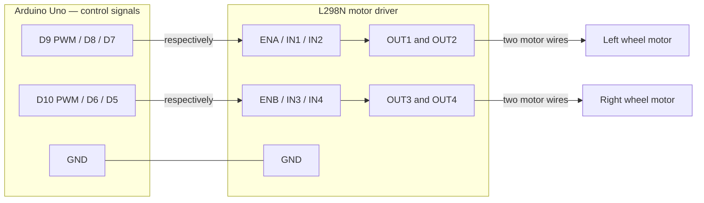

# Lab 3: programming review and proposed wiring

Reviewed 2026-10-08. Chassis assembled; circuit ready to connect. Hardware model and wiring have not yet been confirmed. This is a proposed Arduino Uno + common L298N module mapping, not a verified drawing of the assembled robot.

## What the lab requires

Build reusable, tested driving functions for forward, backward, left and right turns while moving, and in-place rotation. Extend `Motor.ino` to accept speed values and use PWM. Calibrate the robot and build a robust framework that demonstrates its abilities. A Serial Monitor command interface is one suggested approach, not the only acceptable one. Encoder wheels are not used this week; autonomous navigation is not required by this lab.

Also maintain code and usage instructions in GitHub, a circuit diagram in TinkerCAD or Fritzing, and a bill of materials. Post a demonstration video and documentation to Piazza by the night before the next lab, include the repo link, and demonstrate to the TA. Submit the group agreement on Canvas and post it to GitHub. The course recommends using its MyRobot repository as a template; our repository currently contains organizational documents but no sketch.

Source: [Lab 3](https://cogs-300.github.io/labs/lab03).

## Starter code review

Reviewed [MyRobot at commit 6e385b7](https://github.com/COGS-300/MyRobot/tree/6e385b75434afee1c335e896739c24d360590470).

1. **Correctness: fix before testing.** `MyRobot-V2.ino:7–10` starts Serial but never configures the motor pins as outputs. Add `pinMode(..., OUTPUT)` for every enable and direction pin, and explicitly initialize both enable outputs LOW. The inline lab example includes the pin setup; the repository starter omits it.
2. **Incomplete drive functionality.** `Motor.ino:23–26` sets one direction and enables one motor fully using `digitalWrite`. Add speed control with `analogWrite(enablePin, speed)` and reverse direction by exchanging the two input levels. Define and configure a second motor's pins.
3. **Stop semantics.** `Motor.ino:29–32` disables the bridge, which produces a coasting stop rather than active braking. Disable the enable output before changing direction pins. A whole-car stop must disable both channels.
4. **Test responsiveness.** `MyRobot-V2.ino:18,23` uses one-second blocking delays and automatically repeats motion. Adequate for an isolated motor demonstration, but a proposed interactive test loop should use `millis()` so stop commands remain responsive. Start stationary and use finite-duration tests with automatic stop.
5. **Serial is logging only.** `Serial.ino:24–42` prints messages; it does not receive or interpret commands. Add a command parser if choosing the Serial Monitor test interface. Match its existing baud rate of 9600.

The small motor helpers and separated logging file are a useful foundation. Maintainability: good starting separation, unfinished interface. Performance: trivial computation; blocking delays are the relevant limitation. Security: no credential/network handling in these three files; input validation becomes relevant when a command parser is added. This is a source review, not a compiled or hardware-tested result.

Keep `MyRobot-V2.ino`, `Motor.ino`, and `Serial.ino` together in a folder named `MyRobot-V2`; Arduino treats these as one sketch. A suitable future location is `labs/lab-03/src/MyRobot-V2/`.

## Proposed signal connections

Left/right are from the robot's point of view facing its chosen front. Assign channel A to the left wheel and B to the right wheel. The three A pins match the course starter; B pins below are our proposal.

| Arduino Uno | Code name | L298N terminal | Purpose |
| --- | --- | --- | --- |
| D9 (~PWM) | enA | ENA | Left motor speed |
| D8 | in1 | IN1 | Left direction input 1 |
| D7 | in2 | IN2 | Left direction input 2 |
| D10 (~PWM) | enB | ENB | Right motor speed |
| D6 | in3 | IN3 | Right direction input 1 |
| D5 | in4 | IN4 | Right direction input 2 |
| GND | — | GND | Common electrical reference |

Connect OUT1 and OUT2 to the two left motor wires; OUT3 and OUT4 to the two right motor wires. Motors connect across output pairs, not between an output and GND. Read printed terminal labels rather than inferring locations from board orientation.



Remove the ENA and ENB jumper caps when connecting Arduino PWM signals to those enable inputs; the caps otherwise hold the channels enabled. These are different from the regulator jumper, often labeled 5V-EN. Confirm the exact module before applying power.

## Power: course USB bench-test arrangement

For the common L298N module with a removable regulator jumper, and only after confirming that the module matches:

```text
Laptop USB ──> Arduino USB socket
Arduino 5V ──┬──> L298N motor supply terminal (often labeled +12V / VS)
             └──> L298N logic supply terminal (5V)
Arduino GND ─────> L298N GND

5V-EN regulator jumper: removed for externally supplied 5V logic
ENA and ENB jumpers: removed for Arduino PWM control
Battery: disconnected in this arrangement
```

This follows the lab's suggested 5V bench supply. The terminal label “12V” does not mean that 12V is being supplied here. The regulator jumper must be removed when the module's 5V terminal is used as a logic power input. Do not connect the module's regulated 5V output against the Arduino's 5V supply.

USB current limits and the L298 voltage drop can make two motors weak or cause resets, especially when starting or stalled. Start with one motor and wheels raised, and do not leave a stalled motor energized. For an external motor supply, replace the Arduino-to-VS connection with a correctly rated motor supply, retain common ground, and check the actual motor/module ratings and regulator configuration. Do not connect battery positive to Arduino 5V or select a battery solely from the driver's maximum voltage.

Sources: [course power instructions](https://cogs-300.github.io/labs/lab03#2-prototyping-the-control-circuit), [module regulator instructions](https://robu-prod-media.s3.ap-south-1.amazonaws.com/uploads/2017/12/L298N-Module-Pinouts-ROBU.IN_.pdf), [ST L298 datasheet](https://www.st.com/resource/en/datasheet/l298.pdf).

## From code to movement

A direction pair selects electrical polarity. PWM on the enable input controls duty cycle. Physical forward depends on motor orientation and wire order; test and record it independently for each wheel.

| Enable | Input 1 | Input 2 | Electrical result |
| --- | --- | --- | --- |
| 0 | either | either | Disabled; coast |
| PWM > 0 | LOW | HIGH | Rotation in one direction |
| PWM > 0 | HIGH | LOW | Opposite rotation |
| HIGH | equal | equal | Active braking (not the proposed default stop) |

Use a proposed interface `setDrive(left, right)` where each value is from -255 to +255: positive means that wheel drives the car forward, negative means backward, and zero disables the wheel. Each motor should have a calibrated inversion setting. The magnitude becomes `analogWrite(enablePin, abs(value))`; the sign and inversion setting select direction pins. Clamp or reject out-of-range input. Disable drive before reversing polarity and allow the wheel to slow before reversing.

| Movement | Left command | Right command |
| --- | --- | --- |
| Forward | +180 | +180 |
| Backward | -180 | -180 |
| Curve left | +100 | +180 |
| Curve right | +180 | +100 |
| Spin left | -180 | +180 |
| Spin right | +180 | -180 |
| Stop/coast | 0 | 0 |

Values are illustrative PWM commands, not measured speeds. `180/255` is about 71% duty cycle, not 71% of a known wheel speed. A value of 100 may not start your motor. Equal PWM values may require left/right trim to travel straight. A slower inner wheel produces a curve; equal and opposite wheel velocities produce an approximately in-place spin. Exact angles and distances require calibration (and later feedback if needed).

Sources: [Arduino PWM documentation](https://support.arduino.cc/hc/en-us/articles/9350537961500-Use-PWM-output-with-Arduino), [L298 direction/stop truth table, page 8](https://www.st.com/resource/en/datasheet/l298.pdf).

## Suggested implementation and testing order

1. Configure six outputs and verify both motors stay disabled at startup.
2. With the chassis supported, test A alone in each direction; identify physical forward. Repeat for B.
3. Test a few PWM settings. Record minimum starting and running values separately.
4. Implement `setDrive(left, right)` and wrappers for forward, reverse, curves, spins, and stop.
5. Build a Serial Monitor interface: for example `F 180 1000` for forward at PWM 180 for 1000 ms; `B`, `L`, `R`, `Q`, `E` for reverse, curves and left/right spins; `S` for stop. These commands are a proposed design, not implemented code. Reject invalid commands, bound durations and PWM, and stop when a test expires.
6. Use `millis()` to read serial input continuously during tests. Print the requested movement, PWM values, duration, and completion. Never rely solely on a blocking `delay()` for interactive stop behavior.
7. Repeat each movement on the floor with space for the USB lead. Adjust trim and speed thresholds. Record expected versus observed behavior and repeated successes/failures in a test table.
8. Recreate the confirmed wiring in TinkerCAD or Fritzing for the course submission. Update the BOM, usage instructions and demonstration video.

The diagram is a functional connection plan; it has not been checked against a photo of your particular module and is not yet the required TinkerCAD/Fritzing artifact.
